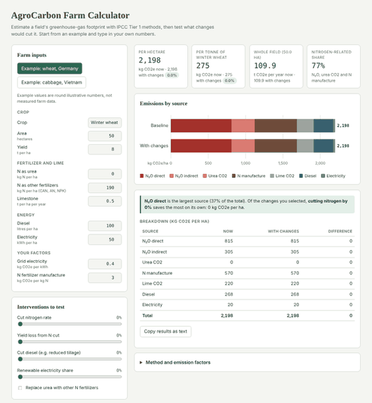
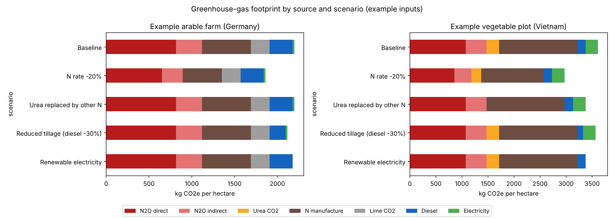

# AgroCarbon: Farm Carbon Footprint Calculator

[](https://github.com/saphal-sharma/agrocarbon/actions/workflows/tests.yml)

**▶ Live app: [saphal-sharma.github.io/agrocarbon](https://saphal-sharma.github.io/agrocarbon/)**: try the calculator in your browser.

> **Question:** Where do a farm's greenhouse-gas emissions come from, and which change cuts them most?  
> **Answer:** Nitrogen fertilizer dominates (77% of the footprint for the wheat example, 89% for cabbage). Cutting the N rate by 20% saves 15–18%; reduced tillage saves only 1–4%.  
> **Method:** IPCC Tier 1 methods in Python with unit tests checked against hand calculations, plus a browser calculator. Example inputs are illustrative, not measured farm data.




AgroCarbon estimates a farm's greenhouse-gas emissions per hectare and per tonne of product, and compares sustainability interventions. It follows the **IPCC Tier 1** methods used in national inventories and many farm carbon tools.



Interactive version: open [`results/dashboard.html`](results/dashboard.html) in a browser. Hover over the bars for totals and per-tonne values.

## Web app

[`docs/index.html`](docs/index.html) is a self-contained interactive calculator: enter your own farm data, move sliders for interventions and see the footprint update instantly. It uses the same IPCC equations as the Python code and gives identical results for the example farms.


## What it calculates

| Source | Method |
|---|---|
| Direct N₂O from fertilizer | N applied × EF1 (0.010) × 44/28 × GWP |
| Indirect N₂O (volatilisation, leaching) | N × (0.11 × 0.010 + 0.24 × 0.011) × 44/28 × GWP |
| CO₂ from urea | t urea × 0.20 t C/t × 44/12 |
| CO₂ from lime | t limestone × 0.12 t C/t × 44/12 |
| Fertilizer manufacture | kg N × supplier or LCA factor (user input) |
| Diesel | litres × 2.68 kg CO₂/l |
| Electricity | kWh × national grid factor (user input) |

N₂O is converted to CO₂-equivalent with GWP100 = 273 (IPCC AR6). Every factor and its source is listed in [`src/factors.py`](src/factors.py), so it can be checked and replaced.

## Scenarios compared

- Cutting the nitrogen rate by 20% (with an optional yield-loss assumption).
- Replacing urea with other nitrogen fertilizers.
- Reduced tillage (30% less diesel).
- Renewable electricity.

## Example results (illustrative inputs)

| Example farm | Total (kg CO₂e/ha) | Per tonne | Nitrogen-related share | Best single measure |
|---|---|---|---|---|
| Winter wheat, Germany | 2,198 | 275 kg/t | 77% | N rate −20%: −15% |
| Cabbage plot, Vietnam | 3,614 | 120 kg/t | 89% | N rate −20%: −18% |

In both examples, emissions linked to nitrogen fertilizer (N₂O, urea CO₂ and fertilizer manufacture) dominate the footprint. Fuel savings from reduced tillage cut emissions by only 1–4%. This matches my M.Sc. thesis research on Vietnamese vegetable farms, where fertilizer accounted for about 82–98% of estimated farm emissions.

**These inputs are round illustrative numbers, not measured farm data.** The manufacturing and electricity factors in particular are placeholders to replace with real values.

## How I checked this

- Unit tests compare direct and indirect N₂O, urea CO₂, lime and diesel emissions with hand calculations from the IPCC formulas.
- The browser calculator uses the same IPCC default factors as the Python code.

## Run it

```bash
pip install pandas matplotlib plotly pytest
python src/footprint.py                  # example farms -> results/footprint_scenarios.csv
python src/footprint.py my_farms.csv     # your own farms, same columns as examples/example_farms.csv
python src/dashboard.py                  # interactive HTML dashboard + PNG
python -m pytest tests                   # checks the IPCC equations against hand calculations
```

## Limitations

- **Tier 1 only:** uses global default factors. Country-specific (Tier 2) factors are more accurate where available.
- **Not yet covered:** soil carbon changes, crop residues, manure and livestock emissions.
- **Fertilizer switching:** the urea scenario assumes the replacement fertilizer has the same manufacturing footprint per kg N. In reality it differs by product.

## References

- IPCC (2006). *2006 IPCC Guidelines for National Greenhouse Gas Inventories*, Volume 4, Chapter 11.
- IPCC (2019). *2019 Refinement to the 2006 IPCC Guidelines*, Volume 4, Chapter 11.
- IPCC (2021). *Climate Change 2021: The Physical Science Basis* (AR6 WG1), Table 7.15.

**Author:** Saphal Sharma, M.Sc. student, Sustainable International Agriculture, University of Göttingen
